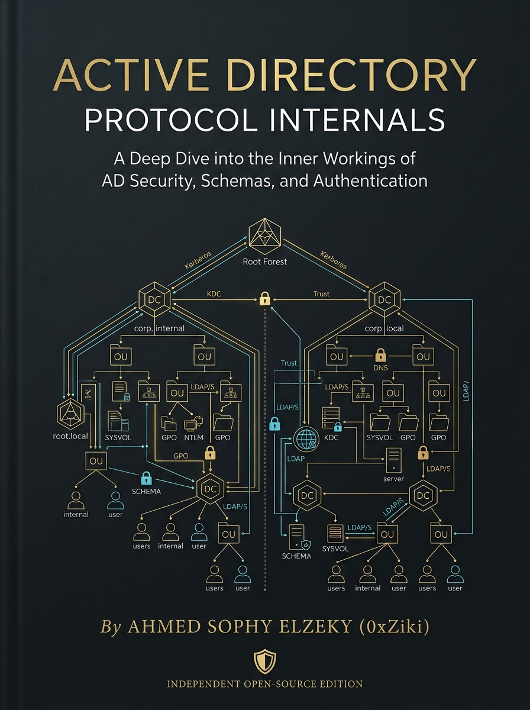

<p align="center">
  
</p>

<p align="center">
  
  
  
  
  
</p>

<h1 align="center">Active Directory Protocol Internals</h1>
<h3 align="center">A First-Principles Guide to Enterprise Identity, Kerberos Cryptography, and Kernel Authorization</h3>
<p align="center"><strong>Volume 1: Foundations (Standalone Complete Edition)</strong><br>
<em>Authored by: Ahmed Sophy Elzeky (0xZiki)</em></p>

---

## 📥 1. Immediate Access & Integrity Verification

Access the definitive compiled manuscript directly from the releases directory. The text has been natively typeset using Typst on Arch Linux to adhere to rigorous academic publishing standards.

[-blue?style=for-the-badge&logo=adobeacrobatreader)](https://github.com/0xZiki/Active-Directory-Protocol-Internals/raw/main/Active_Directory_Protocol_Internals_Vol1.pdf)

**Cryptographic Integrity Verification**
Security operators and researchers must verify the SHA-256 cryptographic hash of the compiled artifact before ingestion. Execute the following Bash snippet to validate the release:

```bash
echo "f7381c8853df45110190ce8743d880241aee1fa1e871444ebb23fb3bf7b8156f  Active_Directory_Protocol_Internals_Vol1.pdf" | sha256sum --check
```

---

## 🏛️ 2. Core Architectural Philosophy: "Zero Tool Dumping"

This engineering textbook firmly rejects the "tool-dumping" paradigm prevalent in modern cybersecurity literature. You will not find generic penetration testing cheatsheets or superficial command-line instructions here. 

This repository is dedicated to **First-Principles Systems Engineering**. It systematically deconstructs the foundational Windows and NTDS architecture to explain *why* specific design decisions were made decades ago. By understanding these design constraints, readers will recognize **Architectural Friction Points**—the inevitable, mathematically predictable vulnerabilities that arise when performance, backward compatibility, and distributed state requirements collide.

**Dual-Perspective Value:**
* **For Offensive Architects (Red Teams):** Master the raw, wire-level packet mechanics, ASN.1 structures, and cryptographic byte arrays required to forge network traffic, engineer custom protocol implementations, and execute zero-dependency attacks.
* **For Detection Engineers (Blue Teams):** Anchor your defenses in high-fidelity Windows Event IDs, RPC endpoint monitoring, and production-grade Kusto Query Language (KQL) detection heuristics explicitly mapped to underlying protocol anomalies.

---

## 📖 3. Table of Contents & Chapter Breakdown

The manuscript is divided into 10 canonical chapters, each mapping to an isolated Markdown file for native web reading.

* **[Chapter 1: Active Directory Architecture & Database Internals](chapters/active-directory-architecture.md)**
  Deconstructs the historical leap from flat SAM databases to the multi-master hierarchical LDAP model. Analyzes the binary structure of the Extensible Storage Engine (`ntds.dit`), the three-layer credential encryption hierarchy, and the deterministic mathematics of DRSUAPI replication conflict resolution.
* **[Chapter 2: Kerberos Authentication & Protocol Triad](chapters/kerberos-authentication.md)**
  Traces the precise cryptographic envelope mechanics of AS, TGS, and AP network exchanges, including AES PBKDF2 key derivation. Dissects the internal ASN.1 structures of the Privilege Attribute Certificate (PAC), dual-signature trust models, and the architectural primitives underlying offline ticket cracking and unconstrained delegation.
* **[Chapter 3: NTLM Authentication & Netlogon Passthrough](chapters/ntlm-authentication.md)**
  Examines the Type 1, Type 2, and Type 3 message exchange powering Microsoft's Challenge-Response fallback mechanism. Explains the critical role of Netlogon secure channels for domain member verification and evaluates the structural deficiencies exposing NTLM to relay attacks despite MIC and EPA/CBT defenses.
* **[Chapter 4: The LDAP Protocol & Directory Query Mechanics](chapters/ldap-protocol.md)**
  Explores the ASN.1 BER wire encoding and the four authentication bind models establishing directory session trust. Analyzes Polish prefix search filter syntax, bitwise matching rule OIDs, and how lack of Channel Binding Tokens (CBT) weaponizes the directory access backbone.
* **[Chapter 5: Security Descriptors, DACLs, SACLs & SDDL](chapters/security-descriptors-acls.md)**
  Breaks down the Windows Security Reference Monitor (SRM) access check algorithm against the binary `nTSecurityDescriptor` attribute. Translates Security Descriptor Definition Language (SDDL) into actionable exploitation primitives, proving that enterprise privilege is a mathematical directed graph rather than a binary status flag.
* **[Chapter 6: Group Policy Objects (GPO) & Declarative Orchestration](chapters/group-policy-objects.md)**
  Explains the split architecture separating the Group Policy Container (GPC) in LDAP from the Group Policy Template (GPT) residing in SYSVOL. Traces version synchronization mathematics via `GPT.INI`, the LSDOU precedence engine, and how Client-Side Extensions (CSEs) translate files into kernel state execution.
* **[Chapter 7: Privileged Groups, Access Tokens & Kernel Enforcement](chapters/privileged-groups-and-tokens.md)**
  Details the transformation of static LDAP directory objects into volatile in-memory Access Tokens within the `ntoskrnl.exe` executive. Analyzes Primary versus Impersonation tokens, Mandatory Integrity Control (MIC), UAC-linked tokens, and the exploitation of Win32 kernel superpowers like `SeDebugPrivilege`.
* **[Chapter 8: Active Directory-Integrated DNS (ADIDNS)](chapters/ad-dns-architecture.md)**
  Investigates why AD relies on DNS as its identity resolution backbone, detailing how zones are hosted as LDAP objects within `DomainDnsZones`. Dissects the Netlogon DC Locator process, SRV record resolution, GSS-TSIG secure dynamic updates, and the security hazards of DNS node DACLs.
* **[Chapter 9: Certificate Services Architecture (AD CS & PKI)](chapters/certificate-services-architecture.md)**
  Analyzes the integration of asymmetric cryptography with Kerberos via PKINIT and the `NTAuthCertificates` trust anchor. Deconstructs Certificate Template Extended Key Usage (EKU) OIDs, MS-ICPR RPC enrollment protocols, and the mathematical identity impersonation flaws caused by arbitrary SAN flags.
* **[Chapter 10: Trust Architecture & Cross-Realm Federation](chapters/trust-architecture.md)**
  Evaluates identity federation without database replication by dissecting the shared Trust Key and Trusted Domain Objects (TDO). Traces the multi-hop Inter-Realm Referral TGT exchange, demonstrating why SID Filtering enforces hard cryptographic boundaries across forests while intra-forest trusts fail to provide true isolation.

---

## 📂 4. Repository Layout & Reading Online

The repository is structured to support both offline PDF consumption and native markdown reading directly via GitHub or Obsidian.

```text
Active-Directory-Protocol-Internals/
├── README.md                           # Master repository directive and synopsis
├── LICENSE                             # CC BY-NC-SA 4.0 Legal terms
├── CITATION.cff                        # Machine-readable academic citation formatting
├── cover.png                           # Official high-resolution volume cover art
├── releases/                           
│   └── Active_Directory_Protocol_Internals_Vol1.pdf  # Compiled, signed release artifact
└── chapters/                           # Raw Markdown source for web/Obsidian reading
    ├── active-directory-architecture.md
    ├── kerberos-authentication.md
    ├── ntlm-authentication.md
    ├── ldap-protocol.md
    ├── security-descriptors-acls.md
    ├── group-policy-objects.md
    ├── privileged-groups-and-tokens.md
    ├── ad-dns-architecture.md
    ├── certificate-services-architecture.md
    └── trust-architecture.md
```

---

## 📜 5. Formal Academic & Professional Citation

If you utilize the concepts, architectural schematics, or KQL heuristics from this volume in academic papers, industrial whitepapers, or operational engagement reports, please use the following BibTeX format for proper attribution:

```bibtex
@book{elzeky2026adinternals,
  author    = {Ahmed Sophy Elzeky},
  title     = {Active Directory Protocol Internals — Volume 1: Foundations},
  year      = {2026},
  edition   = {First},
  publisher = {Active Directory Arsenal Research Project},
  url       = {https://github.com/0xZiki/Active-Directory-Protocol-Internals}
}
```

---

## 👤 6. About the Author

**Ahmed Sophy Elzeky (0xZiki)**  
*Cybersecurity Software Engineer & Offensive Tool Architect*

Ahmed Sophy Elzeky, known in professional security circles as **0xZiki**, is an offensive security engineer and systems architect with deep specialization in enterprise identity protocol internals, raw network protocol engineering, and production-grade security tooling. He is pursuing his Bachelor of Science in Computer Science at Mansoura University, Egypt.

Ahmed’s engineering work is characterized by a commitment to zero-dependency, systems-level implementation. His **Nemesis Core Framework** is a high-concurrency web security platform capable of processing over one thousand requests per second through dual-engine asynchronous architectures and circuit-breaker resilience patterns. **GhostSniffer** is a stealth network discovery engine built entirely on raw sockets with manual RFC 1071 checksum implementations and half-open SYN scanning—designed for environments where third-party dependencies are operationally inadmissible. **UltronNet** provides encrypted custom-protocol communication with automated TLS negotiation, bidirectional port forwarding, and full PTY allocation for persistent access scenarios.

His research agenda centers on the deep mechanics of enterprise identity architectures, bridging the gap between OS internals scholarship and production-grade offensive engineering to make protocol-level knowledge accessible to the next generation of security practitioners.

---

### 🌐 Connect & Research Inquiries

<p align="left">
  <a href="https://github.com/0xZiki"></a>
  <a href="https://linkedin.com/in/YOUR_LINKEDIN_USERNAME"></a>
  <a href="mailto:ahmedelzeky2446@gmail.com"></a>
</p>

* **GitHub:** [github.com/0xZiki](https://github.com/0xZiki)
* **LinkedIn:** [linkedin.com/Ahmed Elzeky](https://www.linkedin.com/in/ahmed-elzeky-a88a3641b/?isSelfProfile=true)
* **Email:** ahmedelzeky2446@gmail.com
---

## ⚖️ 7. Legal, Copyright & Permitted Use

Copyright © 2026 Ahmed Sophy Elzeky.

This work is licensed under the **Creative Commons Attribution-NonCommercial-ShareAlike 4.0 International License (CC BY-NC-SA 4.0)**. 

**Terms of Use:**
* **Permitted:** You are free to share, copy, distribute, and adapt this material for educational, research, and internal organizational defense purposes, provided appropriate attribution is given.
* **Prohibited (NonCommercial):** You may not use this material for commercial purposes. This strictly prohibits unauthorized commercial reselling, locking the material behind subscription paywalls, or utilizing the text/schematics as core curriculum in monetized, for-profit training courses without explicit written permission from the author.

To view a full copy of this license, visit: [https://creativecommons.org/licenses/by-nc-sa/4.0/](https://creativecommons.org/licenses/by-nc-sa/4.0/)